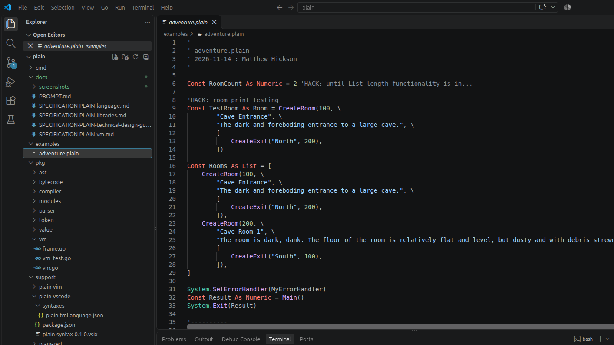
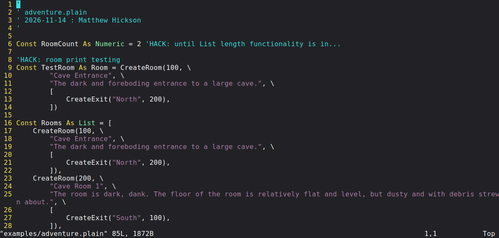

# PLAIN Programming Language

PLAIN (Programming Language Allowing Implementation Neatly) is a statically-typed, BASIC-inspired programming language compiled to custom bytecode and executed on a stack-based virtual machine.

PLAIN, and its associated tooling, is intended to fill software development niches historically attributed to dBase, Delphi, FoxPro, HyperCard, MS Access, PowerBuilder, Xojo, and Visual Basic.

> NOTE: PLAIN is a working-title backronym.

## Project Goals

- **Approachable Syntax:** Clear, English-like keywords and structured blocks (`If...End If`, `For...End For`, `Function...End Function`) inspired by classic rapid application development environments.
- **Explicit Typing:** Enforced variable declarations (`Var x As Numeric`) to catch type mismatches at compile time.
- **Modular Standard Library:** Batteries-included native modules isolated as global namespace structs (e.g., `Console.Print()`).
- **Clean Architecture:** A decoupled pipeline spanning lexing, Pratt parsing, AST construction, bytecode compilation, and virtual machine execution.
- **Interactive Tooling:** A built-in CLI runner and a classic line-oriented REPL supporting both buffered program construction and immediate direct-mode evaluation.

## Implemented Features

- **Primitive Types & Operators:** `Numeric`, `String` (including `+` concatenation), `Boolean`, and `None`.
- **Comments:** Single-quote (`'`) line comments.
- **Control Flow:** Conditional branching (`If...Then...Else...End If`) and range-based loops (`For...To...Step...End For`).
- **Functions & Closures:** First-class functions, recursion, mutual recursion, and lexical closures capturing enclosing scope variables.
- **Data Structures:** Heterogeneous lists (`[1, 2, 3]`) with 1-based indexing, and user-defined `Struct` types with dot-notation property access and assignment.
- **Receiver Functions:** Methods bound to struct types (e.g., `Function (v As Vector2D) Scale(...)`).
- **Standard Library (`pkg/modules`):**
  - `System`: Built-in system functions (`System.SetErrorHandler`, `System.Exit`).
  - `Console`: Built-in terminal I/O functions (`Console.Print`, `Console.PrintLine`, `Console.Input`, `Console.Cls`).
  - `List`: List utilities (`List.Len`, `List.Contains`, `List.Append`, `List.Reverse`).
- **Bytecode Disassembler:** Built-in instruction disassembly for inspecting compiled chunks.

## Language Examples

### Variables and Control Flow
```plain
Var total As Numeric = 0

For i As Numeric = 1 To 10 Step 1
    If i > 5 Then
        total = total + i
    End If
End For
```

### Functions and Closures
```plain
Function MakeAdder(x As Numeric) As Function
    Function Add(y As Numeric) As Numeric
        Return x + y
    End Function
    Return Add
End Function

Var addFive As Function = MakeAdder(5)
Var result As Numeric = addFive(10)
```

### Structs and Receiver Functions
```plain
Struct Vector2D
    X As Numeric
    Y As Numeric
End Struct

Function (v As Vector2D) Scale(factor As Numeric)
    v.X = v.X * factor
    v.Y = v.Y * factor
End Function
```

### System
```plain
Function MyErrorHandler(errMsg As String)
    Console.Print("Caught runtime error: " + errMsg)
End Function

System.SetErrorHandler(MyErrorHandler)

' This will trigger a division by zero error, caught by MyErrorHandler
Var x As Numeric = 10 / 0
Console.Print("Program continued successfully after error.")
```

### Console I/O and Variables
```plain
' Prompt the user and greet them
Console.Print("Hello from the PLAIN standard library!")
Var name As String = Console.Input("What is your name? ")
Console.Print("Nice to meet you, " + name)
```

## Usage

### Running a Source File
Execute a `.plain` file directly from the command line:
```bash
go run cmd/plain/main.go path/to/script.plain
```

### Interactive REPL Mode
Launch the CLI without arguments to start the interactive REPL:
```bash
go run cmd/plain/main.go
```

#### Program Mode vs. Direct Mode

- **Program Mode (Default)**: Entering standard PLAIN statements validates syntax silently and appends the line to the active session buffer without executing it. Use run to execute the buffered script.
- **Direct Mode (! prefix)**: Prefixing an expression or statement with ! (e.g., !10 + 20 or !Console.Cls()) bypasses the session buffer and evaluates the line immediately.

#### REPL Commands
- `help` - Display available REPL commands
- `new` - Clear the current session buffer
- `list` - Display numbered lines currently stored in memory
- `run` - Compile and execute the code in memory
- `edit <line>` - Modify a specific line number (submit a blank line to delete it)
- `save <file>` - Save the current session lines to disk
- `load <file>` - Load a file into the session buffer and execute it
- `exit` / `quit` - Exit the REPL

## Editor Integration Support

The repository includes a support directory containing pre-configured syntax highlighting definitions for popular editors, built on top of a shared TextMate grammar (support/plain.tmLanguage.json).

### Visual Studio Code (`support/plain-vscode/`)

To run the extension locally for VS Code:

Run the extension in VS Code's `Extension Development Host` via:

```
code --new-window \
  --extensionDevelopmentPath="$PWD/support/plain-vscode" \
  "$PWD/examples/adventure.plain"
```

**OR**

Build and install a `VSIX` package.

> NOTE: Xcopy deployment for VS Code extensions is no longer possible.



### Zed (`support/plain-zed/`)

To use the syntax configuration in Zed:

Compile the extension bits provided using Rust.

> NOTE: Zed ditched TextMate support in favour of Tree-sitter compiled WASM.

### Vim / Neovim (`support/plain-vim/`)

To use the native Vim syntax highlighting and filetype detection:

1. Copy the contents of `support/plain-vim/` into your local Vim runtime path (usually `~/.vim/` on Unix or `$HOME/vimfiles/` on Windows; for Neovim, use `~/.config/nvim/`).
    - `ftdetect/plain.vim` maps `.plain` file extensions to the `plain` filetype.
    - `syntax/plain.vim` defines keywords, types, modules, comments, and highlight groups.



## Package Structure

```text
plain/
├── cmd/
│   └── plain/
│       └── main.go          # CLI entry point (file execution and interactive REPL)
├── pkg/
│   ├── ast/
│   │   └── ast.go           # Abstract Syntax Tree node definitions
│   ├── bytecode/
│   │   ├── chunk.go         # Bytecode chunk and constant pool containers
│   │   ├── disassembler.go  # Human-readable bytecode printer
│   │   └── opcode.go        # Opcode definitions and string representations
│   ├── compiler/
│   │   ├── compiler.go      # AST to bytecode compiler and type checker
│   │   └── symbol.go        # Lexical scoping and symbol resolution
│   ├── modules/
│   │   └── console.go       # Built-in Console standard library module
│   │   └── system.go        # Built-in System standard library module
│   ├── parser/
│   │   ├── lexer.go         # Tokenizer (source text to tokens)
│   │   └── parser.go        # Pratt parser (tokens to AST)
│   ├── token/
│   │   └── token.go         # Lexical token types and keyword lookups
│   ├── value/
│   │   └── value.go         # Runtime value representations
│   └── vm/
│       ├── frame.go         # Call frames and closure state
│       └── vm.go            # Stack-based bytecode execution loop
├── support/
│   ├── plain.tmLanguage.json
│   ├── plain-vim/           # Native Vim ftdetect and syntax files
│   ├── plain-vscode/        # VS Code extension package configuration
│   └── plain-zed/           # Zed editor grammar configuration
├── go.mod
└── README.md
```

## Disclaimer

This application was produced using AI (Gemini and Copilot).
